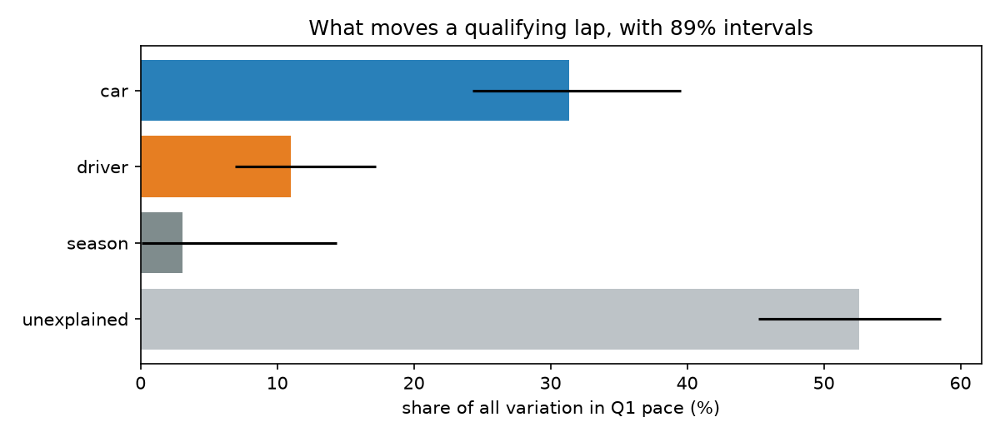
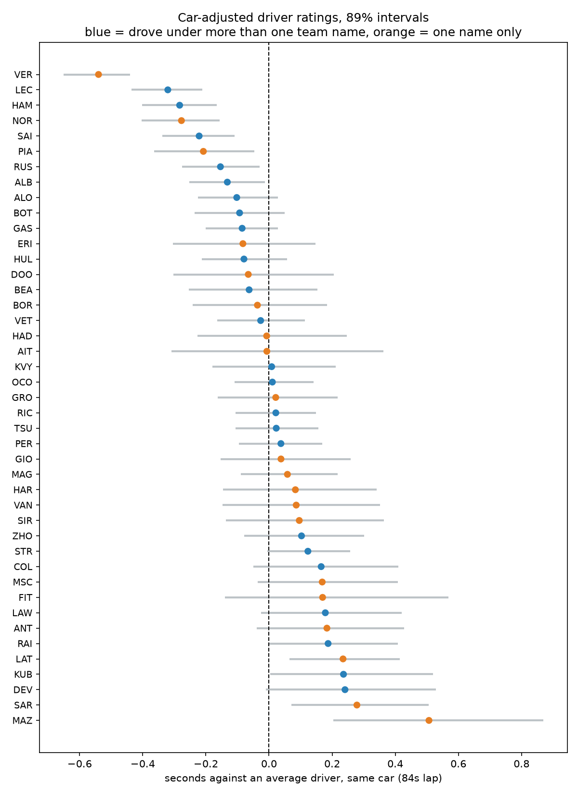
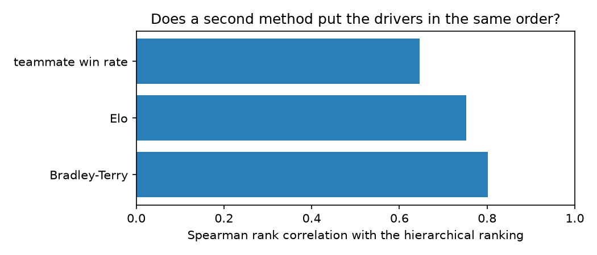

# How much of a Formula 1 result is the driver, and how much is the car?

[](https://github.com/mkhlndrv/f1-driver-vs-car/actions/workflows/ci.yml)

A Bayesian hierarchical model that separates driver skill from constructor strength in Formula 1
qualifying, fitted on 3,008 driver-sessions from 2018 to 2025.

**The answer: car strength accounts for about 2.8 times as much variation in qualifying pace as
driver skill**, 89% interval [1.57, 5.27]. Between the best and worst car in the data there is
2.30s of lap time; between the best and worst driver, 1.10s.

This is an inference problem, not a prediction problem. Predicting the podium is close to solved by
the starting grid alone, and the supporting classifier in this repo demonstrates that by losing to
it. What is hard is attribution: a driver and their car appear together in every observation, so
nothing separates them within a single session. What separates them is drivers changing teams, and
the model is built to use that.

## Contents

- [The result](#the-result): the variance split, in shares and in seconds
- [Why a hierarchical model and not a classifier](#why-a-hierarchical-model-and-not-a-classifier): the
  baseline loses to the starting grid, and that is the argument for everything after it
- [Data](#data): source, counts, and the lap-validity rule
- [The target](#the-target-percentage-gap-to-the-sessions-fastest-q1-lap): why Q1, why not the
  teammate gap, why the 107% rule and the square root
- [What makes the decomposition possible](#what-makes-the-decomposition-possible): 21 of 43 drivers
  changed constructor
- [The model](#the-model): specification, priors, and diagnostics
- [Does the answer hold up?](#does-the-answer-hold-up): prior sensitivity, parameter recovery, and a
  second method
- [What moves the answer](#what-moves-the-answer): every lever tested, and which one is largest
- [What this does not show](#what-this-does-not-show): sandbagging, the covariance the split ignores,
  and one withdrawn result
- [Reproducing it](#reproducing-it): commands, what is committed, and the limits of reproducibility
- [Layout](#layout)
- [Licence and attribution](#licence-and-attribution)

---

## The result



| component | share of all variation | share of what the model explains |
|---|---|---|
| car (team-season) | 31.4% [24.3, 39.5] | 67.3% [49.5, 80.7] |
| driver | 11.0% [6.9, 17.2] | 23.4% [14.0, 35.9] |
| season | 3.1% [0.1, 14.4] | 6.7% [0.2, 27.9] |
| unexplained | 52.6% [45.2, 58.6] | not applicable |

**Read the two columns as different claims.** "The car is 67%" means 67% of the variation the model
accounts for, not 67% of qualifying. The residual is the largest single component in every fit in
this project, and any headline that omits it is overstating the result.

On the dataset's median qualifying lap of 83.9s, the best team-season is worth 2.30s [1.89, 2.72]
over the worst, and the best driver 1.10s [0.87, 1.46] over the worst. Both are best-versus-worst
spreads across the whole period, not a gap between two specific cars in one season.



Interval width is the honest part of that chart. A driver with 154 sessions and a driver with 1 are
not equally well known, and partial pooling shrinks thin records toward the mean rather than letting
one good lap create a rating. Width correlates −0.90 with sessions run.

---

## Why a hierarchical model and not a classifier

The repo contains a conventional podium classifier as a contrast piece. Its result is negative, and
that is the useful part.

On the 2024 and 2025 seasons, held out of every decision and scored once:

| | PR-AUC | precision | recall |
|---|---|---|---|
| LightGBM | 0.6505 | 0.6202 | 0.5674 |
| logistic regression | 0.6488 | 0.6822 | 0.5177 |
| **grid slot only, no model** | **0.6977** | **0.7092** | **0.7092** |

The last row is two no-model references, not one. The PR-AUC comes from ranking the field by
starting slot; the precision and recall come from the rule "the front three on the grid finish on
the podium". Neither involves fitting anything, and both beat both models.

Drop-column tests on the validation seasons say why. Removing `constructor` costs 0.0059 PR-AUC and
removing `driver` costs 0.0180, against a fold-to-fold standard deviation of 0.063. Both are inside
the noise, because the grid slot already contains the driver and the car fused into one number.

That is the whole argument for the rest of this project. **A model can predict a result accurately
and still be unable to say how much of it was the driver.** Separating the two needs a model built
for attribution, and a target chosen so the two are separable at all.

One honest qualifier: on the three validation seasons the models did win, 0.7083 and 0.6793 against
the grid's 0.6460. The models fell 0.029 and 0.059 moving to the test seasons, which is selection
pressure, but the grid reference rose 0.052 on data it was never fitted to, which is those seasons
being more grid-decided. It is not accurate to call the entire earlier advantage selection.

---

## Data

Lap timing comes from the [TracingInsights](https://github.com/TracingInsights) GitHub mirror
(Apache 2.0), not from FastF1 directly. F1's live timing CDN returns 403 to datacenter IPs, so on a
hosted notebook `session.load()` degrades silently: the results table loads while weather, lap
timing and race control all fail. The mirror serves the same data as JSON and was spot-checked
byte-identical against a local FastF1 fetch. Race results and grid slots for the baseline come from
`TracingInsights/RaceData`, which mirrors F1DB/Ergast.

| | count |
|---|---|
| qualifying sessions fetched | 173 |
| laps | 53,690 |
| sessions usable for Q1 pace | 156 |
| driver-sessions | 3,029 |
| driver-sessions after the 107% rule | 3,008 |
| drivers | 43 |
| team names / distinct constructors | 19 / 10 |
| seasons | 8 (2018 to 2025) |

Fourteen sessions lack the `qs` segment labels that identify Q1, Q2 and Q3, and three more produce
no valid Q1 lap. They are excluded and documented rather than reconstructed from lap timing.

A lap counts as valid when `iacc == True & del == False`. Both halves matter: without the deleted-lap
filter, `min(time)` picks up laps that were deleted for track limits, and 625 such laps exist in the
data. The rule was verified against FastF1, which returns `NaT` for the same laps.

---

## The target: percentage gap to the session's fastest Q1 lap

**Why a gap to the fastest lap rather than raw lap time.** Circuits differ by more than a minute a
lap. A gap is comparable across venues without a track term absorbing everything.

**Why Q1 only.** Q1 is the only segment every driver runs. Who appears in Q2 and Q3 is determined
*by pace*, so a per-segment comparison there is selection-biased by construction: measuring how far
apart cars are using only the fastest ten of them is a different question. Q1 covers 156 sessions
against 158 for Q2 and 159 for Q3, so this costs almost no data.

**Why not the teammate gap**, which is the intuitive choice. Both drivers share a car, so
differencing cancels the constructor effect and car strength becomes unestimable. That would remove
the headline question. The teammate comparison earns its place as validation instead, not as the
target.

**Why the 107% rule.** The raw gap has skew 18.3, driven by drivers whose session was disrupted and
who set only one or two valid laps. Two candidate explanations were tested and rejected: referencing
the session median makes skew worse (21.9), and it is not wet running (dry-only is worse at 22.5).
F1's own 107% rule, which is the real regulation for this exact segment, is what fixes it. Fail to
lap within 107% of the fastest Q1 time and you do not qualify. Applying it drops 21 rows of 3,029
and cuts skew to 1.63, which beats inventing a percentile cutoff and having to defend the number.

**Why the square root.** On the filtered data the untransformed gap has skew 1.63, `log1p` gives
0.26 and `sqrt` gives −0.10. The square root was chosen **on posterior predictive shape, not by
`az.compare()`**. LOO scores predictions of whatever quantity a model describes, and a transformed
gap is a different quantity on a different scale, so the branches cannot be ranked against each
other. LOO preferred the model the
shape check rejected: a Normal likelihood on the untransformed gap puts 8.6% of its predictive mass
below zero, which is a lap faster than the session's fastest lap. The square root cannot produce
that, because squaring is never negative.

---

## What makes the decomposition possible

Driver and car are separable because drivers move. **21 of 43 drivers changed constructor** inside
this window. Those moves carry most of the information that separates the two effects: the same
driver in a different car, and the same car with a different driver, are what break the confound.

Two things worth stating precisely, because both are easy to overstate:

- It is 21 who changed constructor, not the 23 who changed team *name*. Sauber raced as Sauber, Alfa
  Romeo Racing, Alfa Romeo and Kick Sauber; treating those as four teams inflates the count and, in
  an earlier version of the held-out test, left a quarter of the supposedly unseen pairings in the
  training data.
- Drivers who never moved still contribute. Verstappen never changed constructor here and has the
  narrowest interval of any driver, because 150 sessions against a rotating cast of teammates is a
  great deal of information.

---

## The model

```
sqrt_gap ~ 1 + (1|drv) + (1|team_season) + (1|season)
```

Crossed random effects in [Bambi](https://bambinos.github.io/bambi/) over PyMC. `team_season` rather
than `team`, because the 2023 Red Bull and the 2024 Red Bull are different cars. Half-Normal
hyperpriors on the group standard deviations (0.3 driver, 0.5 car, 0.3 season), 4 chains, 1,000 tune
and 2,000 draws, `target_accept=0.99`.

Diagnostics on the shipped fit:

| | |
|---|---|
| divergences | 0 |
| worst R-hat | 1.0063 (the season standard deviation) |
| lowest ESS | 1,084 |
| Pareto k above 0.7 | 0 of 3,008 (max 0.35) |
| elpd_loo | −664.3 (se 54.5) |

R-hat and ESS are computed directly in the package rather than via `az.summary`, which returns NaN
for every parameter of these fits in the environment the analysis ran in. The hand-written versions
are checked against known-answer cases in the test suite: independent draws return R-hat 1.0 and
recover the full sample; four chains parked at different means are caught; and an AR(1) series
returns the effective size theory predicts, `n(1-rho)/(1+rho)`, which nothing in the implementation
was fitted to.

---

## Does the answer hold up?

**Priors are not driving it.** Across a 3x change in prior scale the ratio moves 2.804 to 2.822. The
likelihood decides it.

**Parameter recovery on the real structure.** Simulating data with a known true ratio and refitting,
15 independent replicates: **15 of 15 intervals covered the truth** (13.3 expected at 89%), and the
mean shrinkage factor is **1.025 [0.954, 1.095]**, which contains 1.0. No measurable bias. A true
ratio near 1 never produced an upper bound above 2.379, against the 2.804 observed, so the finding
is not an artefact of the machinery.

**A second method, built differently, puts drivers in a similar order.** Teammate duels within a
session give 1,475 head-to-head results, from which three rankings are computed that share no
machinery with the hierarchical model:



| method | Spearman rho vs the hierarchical ranking |
|---|---|
| Bradley-Terry | 0.801 |
| Elo | 0.752 |
| raw teammate win rate | 0.646 |

Agreement rises to 0.812 among the 32 drivers with 20 or more duels, which is the expected direction
if the disagreement is thin records rather than a real conflict. No pass/fail threshold was
pre-committed; the numbers are reported as they came out.

**An independent refit reproduces it.** Deleting the saved posterior and refitting from scratch gave
2.854 against the committed 2.842, with 0 divergences, R-hat 1.0012 and ESS 1,111. MCMC is not
bit-reproducible across machines, and this is the size of drift to expect.

---

## What moves the answer

| lever | ratio |
|---|---|
| **shipped fit** | **2.84** |
| five alternative model terms, notebook 07 (its own baseline is 2.80) | 2.76 to 2.81 |
| controlling for timed laps run, an upper bound rather than a correction | 2.92 |
| removing the 107% filter | 1.9 |
| refit on Q2 / Q3 instead of Q1 | 4.7 / 3.5 |
| **driver effect fitted per season instead of per career** | **5.3 [3.3, 8.5]** |

**Adding structure barely moves it; changing the driver term does.** Adding a circuit term, a session
term, a driver-season term, or both of the last two, moves the ratio between 2.76 and 2.81. On an
89% interval 3.7 wide, which specification you pick matters far less than the sampling uncertainty
already reported.

**A fastest-lap target could reward drivers who get more attempts. It does not.** The run-count slope
is +0.0164 per lap [+0.0118, +0.0210], clear of zero and *positive*: more timed laps go with a worse
gap, not a better one, because a car quick enough to be safe banks one lap and stops while a car on
the bubble has to go out again. Controlling for run count moves the ratio from 2.80 to 2.92. That is
an upper bound rather than a correction, since the adjustment strips out genuine pace along with the
attempts, so the real effect is smaller than the 0.12 shown.

**The largest single lever is an asymmetry in the shipped model.** Driver skill is estimated once per
career while car strength refits every season. Replacing the career-level driver term with a
per-season one raises the ratio to 5.3. That moves the answer *up*, so 2.8 is the conservative end
of this choice rather than the middle of it.

Two things argue against reading 5.3 as the better number, and both come from within the project.
Notebook 07 *adds* a driver-season term while keeping the career term, and it takes **0.15% of the
variance**: once a driver's career level is known, their year-to-year deviation is close to nothing.
So the per-season replacement is not capturing real variation the shipped model misses, it is
declining to pool information the data says should be pooled. And with a driver-season term sitting
beside a team-season term, and most drivers spending a full season at one team, that variant's
driver effect is identified largely by the within-garage teammate difference, which is close to the
reason the teammate gap was rejected as the target in the first place.

**Segments are not a clean swap for one another.** Q2 and Q3 hold fewer cars, drawn from the fastest
part of the field, and Q2 carried a rule from 2014 to 2021 that made front-runners deliberately run
a slower compound. Read 4.7 and 3.5 as "the gap between cars widens when everyone is trying", which
was a written-down prediction that passed, not as competing estimates of the same quantity.

**Adding a session term takes 16.5% of the variance** and cuts unexplained from 52.4% to 37.0%,
while leaving the ratio at 2.81. Most of what the shipped model calls unexplained is session-level
structure, which the target's construction predicts: all twenty gaps in a session are measured
against one reference lap. A circuit term separately accounts for 4.15%. The two are never fitted
together, so there is no combined figure, and deducting only the circuit and calling the remainder
genuinely unexplained would overstate the result.

**The 107% filter is the one choice that pulls the number down.** Removing it, a defensible choice,
gives 1.9. So 2.8 is not a floor in the strict sense. What can be defended is the direction: Q1
measures the car conservatively, because the strongest teams have the most in hand there.

---

## What this does not show

**Q1 sandbagging is real and it biases the result downward.** Drivers in the fastest quarter of the
field improve their own lap by 1.05% from Q1 to Q3 against 0.61% for the slowest quarter, and take
*fewer* timed laps in Q1 while doing it. Both point at the strongest teams holding back where they
can afford to. Conditions and withholding are not fully separable here, and some of the widening is
the track rubbering in.

**The additive split is incomplete.** Driver and car effects correlate at 0.266 [0.185, 0.336] across
the actual assignment, and the covariance term is 18.8% [14.3, 22.9] of the combined driver-plus-car
variance. An additive model assigns that overlap to neither. Good drivers really are hired by good
teams. Weighting by the sessions actually driven rather than counting each driver once gives 2.75
against 2.84 from the hyperparameters, so the ratio survives the assumption even though the split
does not fully resolve.

**A season-by-season competitiveness trend was withdrawn.** It appeared to run from 5.1x in 2019 to
0.70x in 2023, and failed all three checks put to it: 2019 lost 32% when one team was removed, a
robust spread measure weakened the trend, and constructors' championship points moved the opposite
way (rho = −0.762, p = 0.028). Per-season car spread measured from Q1 pace does not measure how
competitive a season was. The failure is itself evidence for the sandbagging problem, since dominant
teams hide the most in Q1.

**Effects compose out of sample only directionally.** On 410 held-out driver-sessions from pairings
never observed, driver-plus-car beats car alone (MAE 0.4216 against 0.4337) and the season average
(0.4765). But those rows come from 9 pairings, and clustering the bootstrap on the pairing gives
[−0.0031, +0.0281], which contains zero. The ordering is right and the margin is not significant.

---

## Reproducing it

```bash
uv sync                 # create .venv and install from uv.lock
make train              # the full pipeline
make test               # 96 tests
make lint               # ruff check + format check
make dashboard          # browse the per-driver and per-car estimates
```

`make train` runs `python -m f1_skill`: fetch, clean, build the Q1 pace table, fit the hierarchical
model, run diagnostics and the decomposition, fit the Elo network and the baseline, then write the
results JSON, the per-level rating tables and the figures. Each stage caches its output under
`data/processed/`, so deleting one file reruns one stage. Adding `--sensitivity` also refits the Q1,
Q2 and Q3 variants, which takes several minutes and is off by default.

The dashboard reads the committed artifacts and never fits anything, which is what makes it safe to
open on a laptop. It exists for the one thing this page cannot hold: all 43 drivers and 81
team-seasons individually, each with its 89% interval, filterable. Raising the minimum-sessions
slider drops the thin records and the wide intervals visibly go with them, which is partial pooling
made concrete; filtering the cars to one constructor shows it across eight seasons. Every number on
it is read from `models/`, so it cannot drift from what is written here.

In Docker, which pins the OS and system libraries as well as the packages:

```bash
docker build -t f1-skill .
docker run --rm -v "$(pwd)/data:/app/data" f1-skill
```

**What is committed and why.** The results JSON, the per-driver and per-car rating tables, and the
figures under `models/` and `reports/` are the deliverable, so anyone can see the answer without
waiting for an MCMC fit. The datasets are not committed; `src/f1_skill/data.py` regenerates them.
The saved posterior is not committed either, at about 10MB, but a cold-start refit reproduces the
headline to within sampler noise. The rating tables exist because that posterior does not ship:
without them there would be no way to read a single driver or car off the fit without refitting.

**How much of the package is exercised.** 456 of 457 statements in `src/` run under the test suite
plus real pipeline runs: one from a cold start with `--sensitivity`, which fits and saves the
posterior, and one reusing it, since those are different branches. The single line never reached is
the warning that prints when R-hat exceeds its threshold, which requires a fit that fails to
converge. CI runs `uv sync --locked`, `ruff` and the tests on every push and pull request.

**On reproducibility limits.** MCMC is not bit-identical across machines or thread counts even with
a fixed seed, so the ratio moves in the third significant figure between runs. Everything
deterministic is exactly reproducible, including the LightGBM baseline, which pins `n_jobs=1,
deterministic=True, force_row_wise=True` and was verified identical across 2, 4 and 8 threads and on
a different machine.

---

## Layout

```
notebooks/         01 EDA, 02 modeling, 03 decomposition, 04 baseline,
                   05 Elo check, 06 sensitivity, 07 specification (kept with outputs)
src/f1_skill/
  data.py          fetch session JSON from the mirror, returned raw
  cleaning.py      lap-validity rule, wet flag, segment handling
  features.py      Q1 pace-gap computation
  models/
    hierarchical.py    the primary model, and hand-written R-hat / ESS
    decomposition.py   variance partitioning and effects in seconds
    elo_network.py     Elo, Bradley-Terry and win rate over teammate duels
    sensitivity.py     variant refits
    baseline.py        the podium classifier
  plots.py         figures, Agg backend
  __main__.py      python -m f1_skill
app/
  streamlit_app.py dashboard over the committed artifacts, never refits
models/            results JSON and the per-level rating tables (committed)
reports/figures/   figures (committed)
tests/             mirrors src/
```

The notebooks are where the analysis was done; the package is the tested code that ships. Every
deterministic figure the notebooks report is reproduced by the package, and the notebooks are kept
with their outputs because those outputs are the record of what was run.

## Licence and attribution

Lap timing data from [TracingInsights](https://github.com/TracingInsights) (Apache 2.0); race
results mirror F1DB/Ergast (CC0). This project is not associated with Formula 1 or any team.
